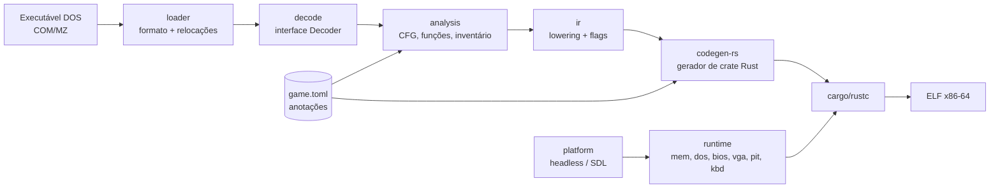
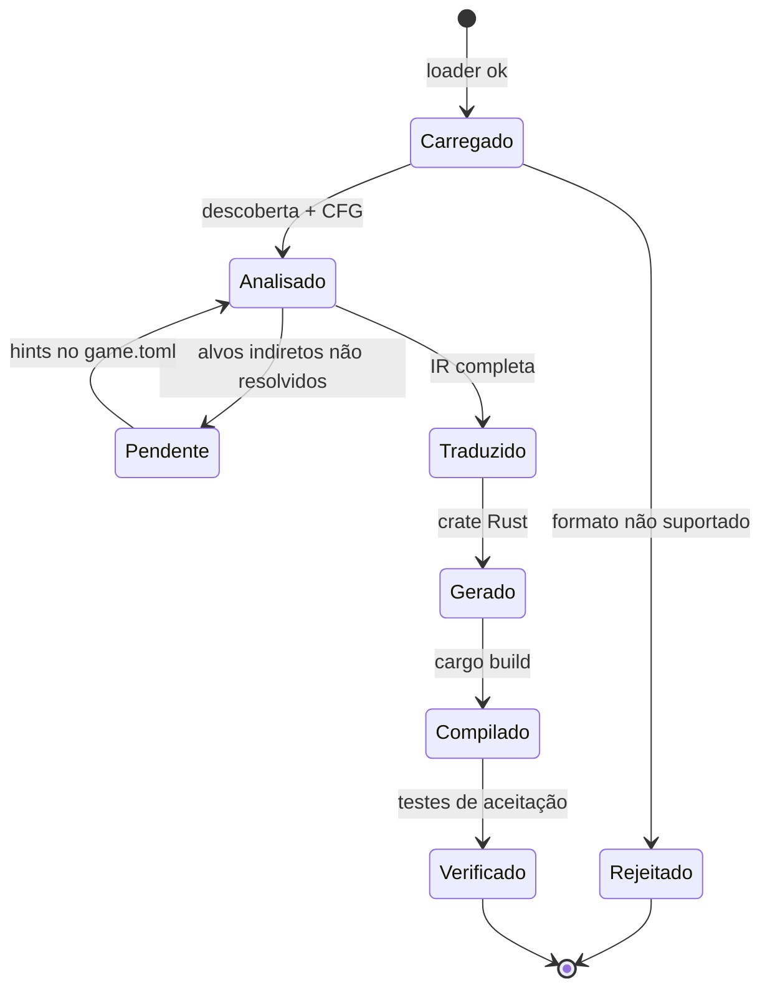
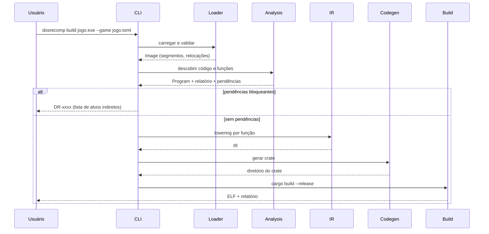

# 04 — Arquitetura, Repositório e Árvore de Documentação

## 1. Visão em camadas



## 2. Crates (workspace)

| Crate | Responsabilidade | Depende de | Usa `pyrsutils`? |
|---|---|---|---|
| `dosrecomp-cli` | Subcomandos, parsing de argumentos, relatório | todos os crates da ferramenta | **Sim** (`input`, `print`, `fs_utils`, `time_utils`, strings) |
| `dosrecomp-loader` | COM/MZ, relocações, PSP, detecção de formatos | — | Não |
| `dosrecomp-decode` | Interface `Decoder`; adaptador para `iced-x86` | `iced-x86` | Não |
| `dosrecomp-analysis` | Descoberta de código, CFG, funções, inventário, vivacidade | loader, decode | Não |
| `dosrecomp-ir` | IR, lowering, otimizações locais | decode | Não |
| `dosrecomp-codegen` | IR → crate Rust; formatação determinística | ir | Não |
| `dosrecomp-build` | Invocar `cargo`, verificar ELF, relatório | — | Parcial (`time_utils`, `fs_utils`) |
| `dosrecomp-runtime` | Biblioteca ligada ao jogo gerado: `Machine`, `Mem`, DOS/BIOS/VGA/PIT/teclado | `platform` | Não (política em `09`) |
| `dosrecomp-platform` | `trait Platform`; backends `headless` e `sdl` | SDL (opcional) | Não |
| `dosrecomp-verify` | Harness diferencial, traços, comparação de quadros | runtime | **Sim** (`histogram`, `enumerate`, strings, `timeit`) |

Justificativa de `pyrsutils` restrito: ver `09` §4. A biblioteca é um único arquivo (`mod pyrsutils;`), portanto é copiada nos crates que a usam ([D], ADR-0008).

## 3. Fluxo de dados e estados



## 4. Sequência de uma conversão



## 5. Estrutura do código gerado

```mermaid
flowchart TB
    subgraph Crate gerado
      M[main.rs<br/>carrega imagem, cria Machine, chama entry]
      F[funcs/*.rs<br/>fn f_CSSEG_OFF(m: &mut Machine)]
      D[dispatch.rs<br/>tabela CS:IP → fn]
      T[tables.rs<br/>imagem de dados + relocações aplicadas]
    end
    R[dosrecomp-runtime] --> M
    M --> D --> F
    F -->|rt.int21 / port_in / port_out| R
```

Cada função gerada recebe `&mut Machine` (registradores, flags preguiçosas, memória, dispositivos). Chamadas diretas entre funções traduzidas usam chamada Rust; `CALL FAR`, `RET` com retorno alterado e saltos indiretos passam pelo despachante (`05` §6). `extern "C"` aparece somente nas fronteiras FFI da plataforma (SDL) [D].

## 6. Interfaces principais (assinaturas propostas, não implementadas)

```rust
// dosrecomp-decode
pub trait Decoder { fn decode(&self, bytes: &[u8], ip: u16, mode: CpuMode) -> Result<Insn, DecodeError>; }

// dosrecomp-loader
pub struct Image { pub segments: Vec<Segment>, pub entry: SegOff, pub stack: SegOff, pub relocs: Vec<SegOff>, pub kind: ImageKind }
pub fn load(bytes: &[u8], limits: &Limits) -> Result<Image, LoadError>;

// dosrecomp-platform
pub trait Platform {
    fn present(&mut self, indexed: &[u8; 64000], palette: &[[u8; 3]; 256]);
    fn poll(&mut self) -> Vec<PlatformEvent>;
    fn push_audio(&mut self, pcm: &[i16]);
    fn now_ns(&self) -> u64;
}
```

Estas assinaturas são proposta de projeto [D]; os tipos exatos são definidos na Fase 1.

## 7. Estrutura do repositório

```
dosrecomp/
├── Cargo.toml                  # workspace
├── crates/
│   ├── dosrecomp-cli/          # + src/pyrsutils.rs (cópia)
│   ├── dosrecomp-loader/
│   ├── dosrecomp-decode/
│   ├── dosrecomp-analysis/
│   ├── dosrecomp-ir/
│   ├── dosrecomp-codegen/
│   ├── dosrecomp-build/
│   ├── dosrecomp-runtime/
│   ├── dosrecomp-platform/
│   └── dosrecomp-verify/       # + src/pyrsutils.rs (cópia)
├── corpus/                     # programas de teste próprios (fonte .asm + binário)
├── games/                      # *.toml de anotações (sem assets)
├── docs/                       # esta documentação
├── fuzz/                       # alvos de fuzzing
└── tests/                      # testes de integração
```

Sem arquivos de jogos no repositório (RN-05).

## 8. Árvore de documentação (evolução)

| Pasta/arquivo | Conteúdo | Quando |
|---|---|---|
| `docs/00…10` | Esta especificação | Fase 0 |
| `docs/games/<jogo>.md` | Relatório por jogo: inventário, desvios, status | por jogo |
| `docs/adr/NNNN-*.md` | ADRs individuais (migrar de `10` ao crescer) | F1+ |
| `docs/diag/DR-xxxx.md` | Catálogo de diagnósticos | F1+ |
| `CHANGELOG.md` | Versões | F1+ |

## 9. Responsabilidades fora de cada módulo

| Responsabilidade | Dono | Observação |
|---|---|---|
| Semântica de instruções | `ir` | Única fonte de verdade; `codegen` só serializa |
| Serviços DOS/BIOS | `runtime` | Nunca dentro do código gerado |
| Entrega de interrupções | `runtime` + safe points do `codegen` | INV-09 |
| Escolha de modelo de CPU | `game.toml` → `ir` | RN-03 |
