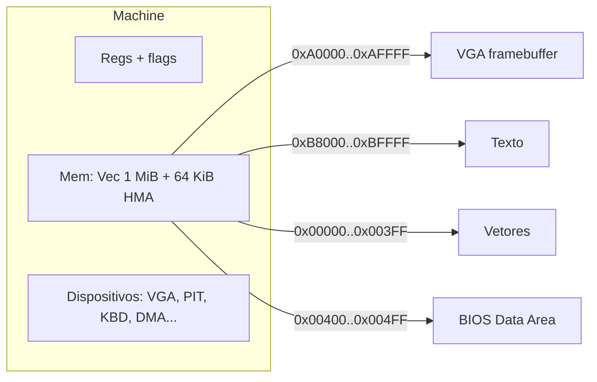

# 05 — x86 de Origem, x86-64 de Destino, Memória e Tradução

Fontes primárias: Intel SDM (volumes 1–3); formato MZ: wiki.osdev.org/MZ, moddingwiki.shikadi.net, formats.kaitai.io/dos_mz; ABI: gitlab.com/x86-psABIs/x86-64-ABI. `ASMx86x64.pdf` é secundária e declaradamente não aprofunda o modo real (`00` §5). Os valores marcados [F] abaixo são conhecimento consolidado de arquitetura; confirmação formal contra o SDM é a tarefa T-DOC-01 (Fase 0).

## 1. Formatos de entrada

### 1.1 COM [F]

- Um único segmento de até 64 KiB (menos 256 bytes do PSP e a pilha); sem cabeçalho.
- Carregado em `CS:0100h`; `CS=DS=ES=SS` = segmento do PSP; `IP=0100h`; `SP` perto do topo do segmento (`FFFEh` quando há memória).
- Sem relocações.

### 1.2 MZ EXE [F]

| Offset | Campo | Observações |
|---|---|---|
| 00h | assinatura `MZ` (também `ZM`) | |
| 02h | bytes na última página | 0 = página cheia |
| 04h | nº de páginas de 512 bytes | tamanho do módulo = (páginas−1)×512 + última |
| 06h | nº de relocações | |
| 08h | tamanho do cabeçalho em parágrafos | |
| 0Ah / 0Ch | minalloc / maxalloc em parágrafos | |
| 0Eh | SS inicial (relativo ao segmento de carga) | |
| 10h | SP inicial | |
| 12h | checksum | normalmente ignorado |
| 14h | IP inicial | |
| 16h | CS inicial (relativo) | |
| 18h | offset da tabela de relocações | |
| 1Ah | número de overlay | |
| 3Ch | `e_lfanew` (extensão) | aponta para `NE`, `LE`, `LX` ou `PE` |

Algoritmo de relocação [F]: para cada entrada `seg:off` da tabela, o word em `(load_seg + seg)*16 + off` do módulo recebe `+ load_seg`. O segmento de carga é imagem do PSP+10h.

**Regras de validação do loader (RF-FMT-03, RNF-SEC-02):** páginas/última página coerentes; cabeçalho ≤ tamanho do arquivo; tabela de relocações dentro do arquivo e de dentro do módulo; cada entrada aponta para word dentro da imagem; CS:IP e SS:SP dentro da imagem ou memória alocada; `minalloc ≤ maxalloc`; limites configuráveis (RNF-SEC-03).

### 1.3 Extensões e compressão

| Caso | Tratamento no MVP |
|---|---|
| `e_lfanew` válido com `NE`/`PE` | Rejeitar (DR-0101), fora de escopo |
| `LE`/`LX` (DOS/4GW etc.) | Rejeitar (DR-0102); candidato à F8 |
| Bytes após o módulo (overlay) | Registrar como dados anexos (RF-FMT-07, F5) |
| LZEXE/PKLITE e assemelhados | Detectar por assinatura e rejeitar (DR-0103); descompressão offline é decisão futura [P] |
| Executáveis com checagem de integridade/proteção | Fora de escopo (`01` §9) |

## 2. x86 real mode — pontos de semântica relevantes

| Tema | Regra / risco | Tratamento proposto |
|---|---|---|
| Endereçamento | físico = `seg×16 + off`; 20 bits; offset de 16 bits com wrap | INV-02, INV-04; função `lin(seg, off) -> u32` |
| A20 / HMA | Com A20 ligado `FFFF:0010…FFFF:FFFF` alcança ~64 KiB acima de 1 MiB; com A20 desligado há wrap em 1 MiB | Opção `a20 = off|on`, padrão `on` [P] (ADR-0011) |
| Registradores | AX,BX,CX,DX,SI,DI,BP,SP,IP + CS,DS,ES,SS; AL/AH etc. | Struct de `u16` com acessores 8 bits |
| Flags | CF,PF,AF,ZF,SF,TF,IF,DF,OF; bits reservados | Flags preguiçosas (§4) |
| Segment override e padrões | DS padrão; SS para BP/SP; ES para DI em strings | Tabela no `lowering` |
| Prefixos `66h/67h` | Em real mode, permitem operandos/endereços de 32 bits (386+) | Rejeitar com diagnóstico no modelo 8086; suporte futuro [P] |
| Modelo de CPU | Diferenças 8086 vs 186/286/386 (máscara de contagem de deslocamento, `PUSH SP`, opcode `0Fh`) | RN-03: padrão 8086 estrito |
| `DIV/IDIV` | Quociente fora da faixa ou divisor 0 → `INT 0` | RF-IR-04 |
| Strings | `MOVS/CMPS/SCAS/LODS/STOS` com `REP`; dependência de `DF` e segmentos | Operações em bloco no runtime com semântica exata de CX |
| `LOOP/JCXZ` | Usam CX | IR direta |
| `IN/OUT` | Portas de hardware | Chamadas ao runtime (RF-RT-*) |
| BCD | `AAA/AAS/AAM/AAD/DAA/DAS` não existem em x86-64 | Implementar na IR (RF-IR-05) |
| `INTO`, `BOUND`, `IRET` | Interrupções e retornos | `IRET` restaura IP/CS/FLAGS da pilha emulada |
| x87/FPU | Jogos podem usar FPU ou emulação via `INT 34h–3Dh` | [H]; fora do MVP |
| `HLT` | Espera por interrupção | Safe point: roda eventos até haver IRQ |

## 3. Origem versus destino

| Aspecto | x86 real mode (origem) | x86-64 SysV (destino) | Consequência |
|---|---|---|---|
| Largura | 16 bits (8 em parciais) | 64 bits | Estado emulado em variáveis; sem mapeamento 1:1 para registradores nativos |
| Memória | segmentada, 1 MiB | linear, 48 bits virtuais | `Mem` com vetor de bytes e `lin()` |
| Pilha | `SS:SP` em memória do jogo | pilha nativa 16-byte alinhada | Pilha do jogo é emulada em `Mem`; pilha nativa só para chamadas Rust |
| Convenção de chamadas | sem padrão (cada jogo define) | `RDI,RSI,RDX,RCX,R8,R9`; callee-saved `RBX,RBP,R12–R15` | Funções geradas recebem `&mut Machine`; ABI SysV só importa em FFI (`extern "C"`) e na chamada ao ELF pelo SO |
| Flags | bits em FLAGS 16 | RFLAGS | Cálculo explícito/preguiçoso, nunca copiar flags nativas |
| Instruções | CISC 16 bits, BCD, `LOOP`, `ENTER/LEAVE` | Sem BCD; novas | Tradução semântica, não opcode a opcode |
| Alinhamento | sem exigência | 16 bytes no `call` | Responsabilidade do `rustc` |
| E/S | `IN/OUT` | instruções privilegiadas no Linux (não usáveis) | Camada de compatibilidade |
| Interrupções | vetores em `0000:0000` | sinais/eventos SO | Despacho em safe points |

**Fato relevante para a ABI [F]:** como o backend é código Rust compilado, a ABI SysV aplica-se à fronteira com o SO e com bibliotecas C (SDL, libc). Entre funções geradas usamos o ABI Rust, que não é estável nem especificado como o SysV [D]; isso é irrelevante porque tudo é compilado junto.

## 4. Flags preguiçosas

Em vez de calcular as 6 flags aritméticas em toda instrução, a IR guarda `(op, a, b, resultado, largura)` na instrução que as define e materializa `CF/PF/AF/ZF/SF/OF` apenas quando consumidas (`Jcc`, `ADC/SBB`, `PUSHF`, `LAHF`, entrega de interrupção). Com análise de vivacidade (RF-DEC-10), muitos cálculos desaparecem. Risco: erros sutis em `AF`, `OF` de deslocamentos/rotações e flags indefinidas (INV-06). Estratégia de teste: tabela exaustiva 8 bits e amostrada 16 bits contra o oráculo (T-IR-02).

## 5. Pipeline de análise e tradução

1. **Carga:** `Image` com bytes e relocações aplicadas (ou marcadas).
2. **Descoberta:** worklist a partir de `CS:IP`; cada instrução decodificada e classificada (fluxo: sequencial, salto, chamada, retorno, interrupção, `HLT`).
3. **CFG/funções:** blocos básicos; funções = alvos de `CALL`; `CALL FAR` e `RETF` marcam segmentos.
4. **Código vs dados:** bytes nunca alcançados ficam como dados; sobreposição de instrução e dado gera diagnóstico (RF-DEC-05).
5. **Alvos indiretos:** padrões (`JMP [BX*2+tabela]`), hints do `game.toml`; sem resolução → pendência (RF-DEC-07).
6. **Inventário:** `INT n`, `AH`, portas, regiões (A000, B800, 40:xx) (RF-DEC-11).
7. **IR:** lowering por instrução; flags explícitas; safe points.
8. **Otimização local:** vivacidade de flags, propagação de constantes de segmentos; **nenhuma** transformação que mude semântica de memória/E/S.
9. **Geração:** crate Rust (`06` §3).

## 6. Chamadas, retornos e saltos indiretos

| Situação | Tratamento |
|---|---|
| `CALL near` direto | Chamada Rust à função traduzida; o endereço de retorno é empilhado em `Mem` (necessário para código que inspeciona a pilha) |
| `RET` | Verifica que o topo da pilha emulada é o endereço esperado; se diferir, entra no **despachante** (retorno não local) |
| `CALL/JMP indireto` | Despachante `dispatch(cs, ip)`: tabela estática de pontos de entrada conhecidos; desconhecido → `rt::unresolved` (abort com diagnóstico, INV-03) |
| Troca de pilha (SS:SP) | Permitida; `Mem` não assume pilha única |
| Corrotinas/threads de jogo (troca de SP) | Fora do MVP; risco R-07 |
| Código dentro de dados / sobreposição | Diagnóstico; tratamento manual via `game.toml` |

## 7. Modelo de memória em Rust seguro

- `Mem` é `Vec<u8>`; acessos: `rb/rw/wb/ww(seg, off)`; escrita em regiões mapeadas (VGA, texto) notifica o dispositivo.
- Sem `unsafe` e sem ponteiros crus (RNF-SEC-01). Custo: verificação de limites em cada acesso; mitigado por índices máscarados a 20/21 bits e tamanho fixo [H].
- Mapa PC típico [F]: IVT `00000–003FF`; BDA `00400–004FF`; memória convencional até `9FFFF`; VGA gráfico `A0000–AFFFF`; texto colorido `B8000–BFFFF`; ROM BIOS `F0000–FFFFF`. (Contradiz o trecho do PDF secundário sobre `90000–9FFFF`; ver `00` §5.)

## 8. Interrupções e temporização

- Hardware simulado gera eventos (timer, teclado) no `Machine`.
- Entrega em **safe points** (INV-09): o código gerado chama `m.poll()` em back-edges, antes de `CALL`, após `OUT`, em `HLT` e `INT`. Se há IRQ pendente e `IF=1`, o runtime empilha FLAGS/CS/IP e chama o handler **traduzido** do vetor atual (que pode ter sido instalado pelo jogo via `INT 21h AH=25h` ou escrita direta na IVT).
- Handlers dentro do jogo devem estar traduzidos e no despachante; vetor que aponta para código desconhecido → diagnóstico.
- Tempo: modos `virtual` (determinístico, ciclos estimados por instrução [H]) e `real` (relógio do hospedeiro). Testes usam `virtual`.
- Limitação conhecida [L]: loops de espera por "N ciclos" calibrados por CPU não terão duração fiel; aceitável quando baseados em PIT/retrace.

## 9. Código automodificável e carregamento dinâmico

Detecção estática limitada: escrita em região classificada como código gera diagnóstico (RF-DEC-08). Se confirmado (inclusive via aliasing de segmento), o jogo fica fora do escopo (RN-01). Overlays que carregam código novo de disco também ficam fora no MVP.

## 10. Ponto de entrada e conclusão

`main` do ELF: cria `Machine`, carrega imagem/dados, aplica PSP, configura pilha inicial e chama a função de entrada. `INT 21h AH=4Ch` e `INT 20h` terminam o processo com o código de saída do programa DOS. Nenhum código x86 é executado: apenas funções Rust geradas.
